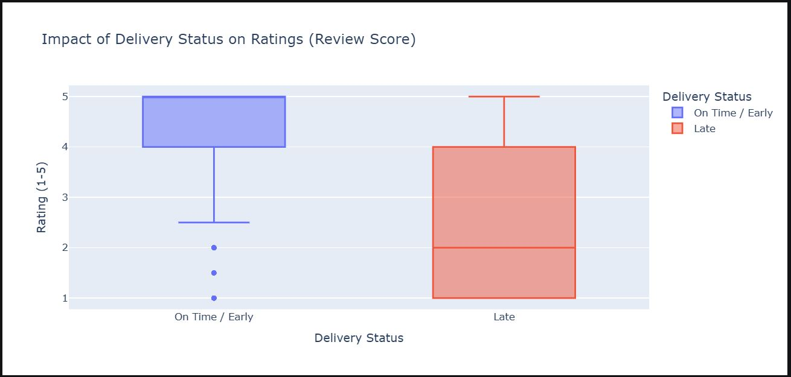
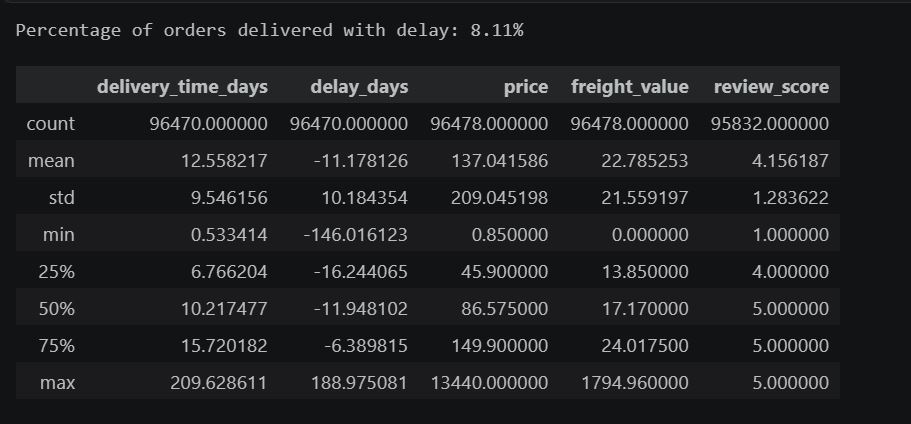
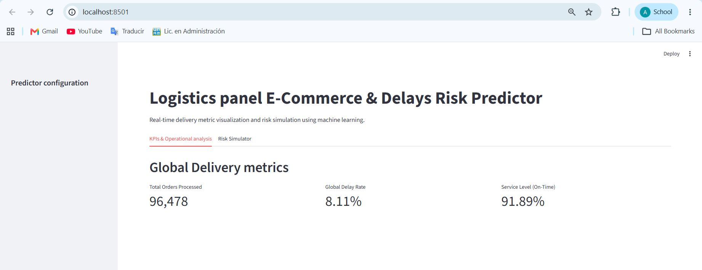
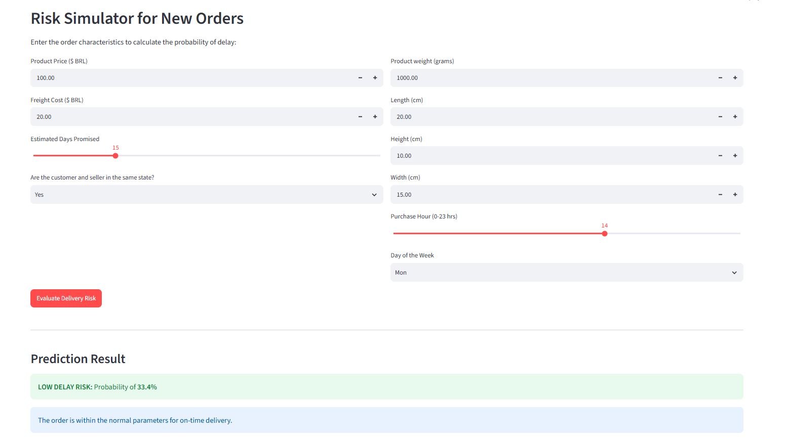
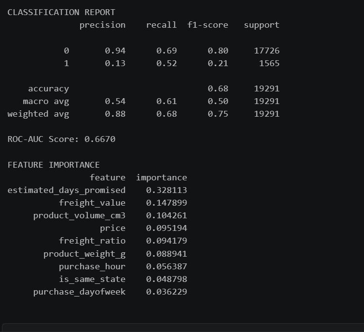

# E-Commerce Logistics Pipeline & Delay Prediction App

An end-to-end data engineering, analytics, and machine learning pipeline built to optimize e-commerce logistics and predict delivery delays using the **Olist Brazilian E-Commerce Dataset** (+100k real-world orders).

## Project Architecture

1. **Data Ingestion & ETL (`src/etl.py`)**: Ingested and integrated a relational schema of 9 separate CSV tables into a local SQLite database using `SQLAlchemy` and `Pandas`.
2. **Exploratory Data Analysis & SQL (`notebooks/01_eda.ipynb`)**: Executed complex SQL joins and aggregations to analyze logistics SLAs, delivery performance, and customer satisfaction metrics.
3. **Predictive Modeling**: Trained a `Random Forest` classification model engineered to identify orders at high risk of shipping delays (achieving a **0.67 ROC-AUC** score).
4. **Interactive Web App (`app/app.py`)**: Built and deployed a dynamic dashboard using `Streamlit` featuring real-time KPI tracking and a machine learning risk simulator for new orders.

## Tech Stack & Tools

* **Language:** Python 3.10+
* **Database & ORM:** SQLite, SQLAlchemy
* **Data Processing & Analytics:** Pandas, NumPy
* **Data Visualization:** Plotly Express
* **Machine Learning:** Scikit-Learn, Joblib
* **Deployment & UI:** Streamlit

## Key Business Insights

* **Delay Rate:** Exactly **8.11%** of fulfilled orders experienced logistics delays beyond the promised delivery date.
* **Customer Satisfaction Impact:** Order delays severely impact customer retention, dropping average review scores from **~4.2 stars** (on-time) down to **~2.4 stars** (delayed).
* **Feature Importance:** Freight ratio (shipping cost relative to item price), package volume ($\text{length} \times \text{width} \times \text{height}$), and product price were identified as the strongest predictors of delivery delays.

## Repository Structure

eccomerce_olist_pipeline/app/app.py #Streamlit web aplication & simulator\
eccomerce_olist_pipeline/data/raw/  #Source CSV files (Olist dataset) \
eccomerce_olist_pipeline/data/model_rf.joblib     # Serialized Random Forest model\
eccomerce_olist_pipeline/notebook/01_eda.ipynb        # Data exploration, SQL queries & ML training\
eccomerce_olist_pipeline/src/etl.py              # Automated ETL script for SQLite ingestion\
eccomerce_olist_pipeline/requirements.txt             # Python package dependencies

## Key findins & Results
### Impact of Delivery Status on Customer Satisfaction

* **High Satisfaction for On-Time Deliveries:** Orders delivered on time or early maintain a median rating of **5 stars**, with more than 75% of users rating their experience between 4 and 5 stars.
* **Severe Rating Collapse on Delays:** When a package is delayed, the median score drops drastically to **2 stars**.
* **Key Takeaway:** Over 75% of delayed orders receive a score of 4 stars or lower, with a heavy concentration of 1-star ratings. This proves that shipping speed is the single most critical factor driving negative customer reviews.
### Descriptive Statistics

* **Low Overall Delay Rate:** Only **8.11%** of delivered orders missed their estimated delivery window.
* **Delivery Time Variance & Outliers:** The average delivery time is **12.56 days** with a high standard deviation of **9.55 days**. The maximum value of **209.6 days** indicates extreme logistics bottlenecks that skew the average; the median (**10.22 days**) represents typical fulfillment performance more accurately.
* **Generous Estimation Buffers:** The negative mean for `delay_days` (**-11.18 days**) shows that the platform's initial estimation model builds in conservative safety buffers, delivering packages roughly 11 days before the promised deadline on average\.
* **Review Score Distribution:** The average rating remains high at **4.16 stars** ($\sigma = 1.28$), confirming that the overall customer sentiment is positive as long as orders arrive within the promised window[cite: 4].

### Interactive Dashboard

* **Real-Time Database Integration:** The Web Application connects directly to the processed SQLite database, displaying live aggregated metrics across **96,478 delivered orders**\.
* **Core Logistics Metrics (SLA):** Offers immediate visibility into high-level business indicators:
  * **Total Orders Processed:** 96,478 orders\
  * **Global Delay Rate:** 8.11%\
  * **On-Time Service Level Agreement (SLA):** 91.89%\
* **Modular UI Design:** Built with a tabbed architecture (`KPIs & Operational Analysis` and `Risk Simulator`) to separate executive-level monitoring from interactive predictive simulations\.

### Real-Time Machine Learning Delay Risk Simulator

* **Live Model Inference:** Connects the trained `Random Forest` model (`model_rf.joblib`) to an interactive UI for evaluating delivery risk prior to checkout or dispatch.
* **Custom Feature Input:** Enables operators to input real-time shipment attributes, including product price ($100 BRL), freight cost ($20 BRL), promised delivery timeline (15 days), location flags, package dimensions, and purchase timing.
* **Automated Risk Scoring & Decision Support:** Calculates derived features on the fly (e.g., freight ratio and total package volume in $\text{cm}^3$) to output an instant delay probability (e.g., **LOW DELAY RISK: 33.4%**) accompanied by clear operational recommendations\.

### Feature Importance & Delay Drivers

* **Dominant Risk Factors:** The model identifies **Freight Ratio** (`freight_ratio`), **Freight Cost** (`freight_value`), **Product Volume** (`product_volume_cm3`), and **Item Price** (`price`) as the primary drivers of shipping delays, accounting for over 75% of total predictive power.
* **Volume & Freight Dynamics:** Larger and bulkier products naturally increase shipping costs (`freight_value`) and demand specialized cargo handling or longer routing, significantly increasing the probability of logistics bottlenecks.
* **Economic & Distance Proxy:** High freight costs relative to item price (`freight_ratio`) often serve as a strong proxy for long-distance or cross-state deliveries, where inter-modal transfers add delay risk.
* **Operational Insight:** Time-based variables (like purchase hour or day of the week) have minimal impact compared to physical product dimensions and shipping economics.

